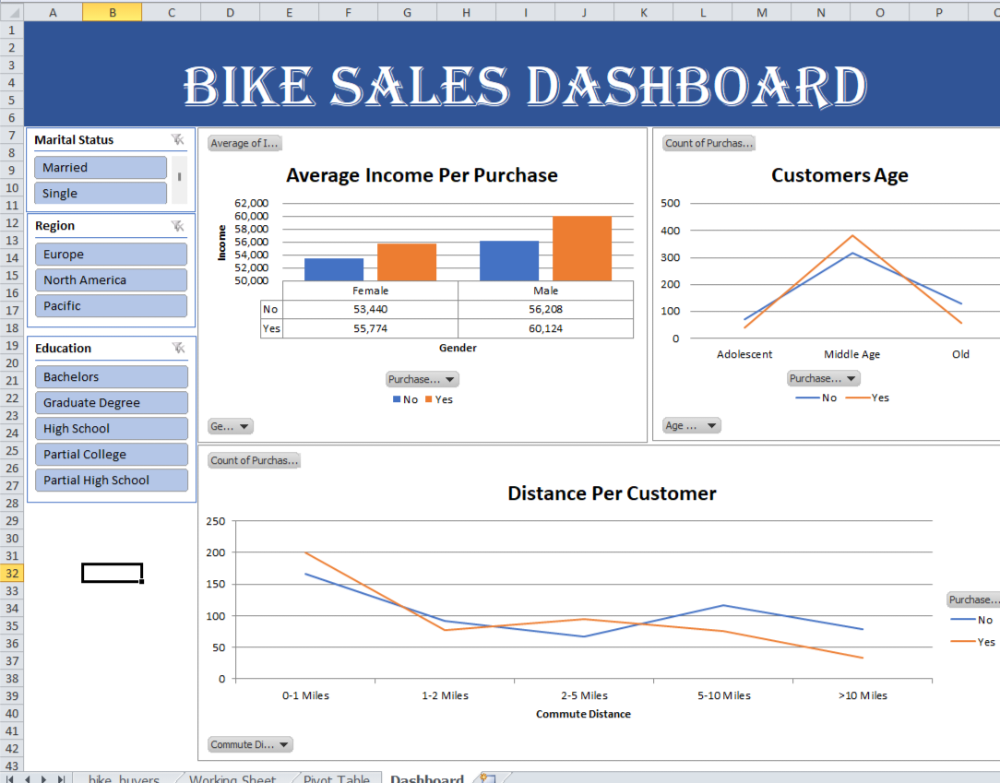

# Bike Sales Dashboard

## Goal
Find out which customers are most likely to buy a bike, using customer data.

## Dataset
bike_buyers dataset with customer details such as gender, age, income, education, marital status, region and commute distance.

## Tools
* Microsoft Excel
* Pivot Tables
* Slicers
* Charts

## What I Did
* Cleaned the data
* Built pivot tables to summarise purchases
* Created charts for income, age and distance
* Added slicers for Marital Status, Region and Education
* Combined everything into one dashboard

## Key Insights
* Buyers earn more on average than non buyers for both genders.
* Male buyers have the highest average income at 60,124.
* Middle aged customers are the largest group.

## Files
* Bike Sales Excel Project Dataset.xlsx: the full analysis
* bike-sales-dashboard.png: the dashboard screenshot
